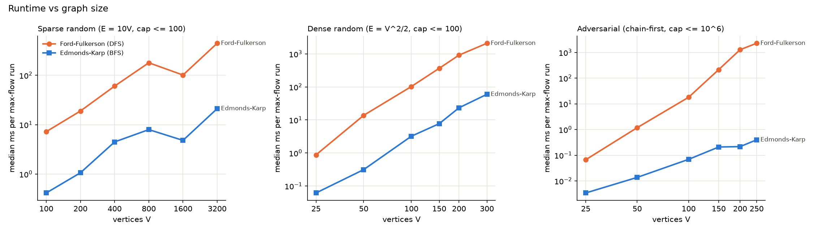
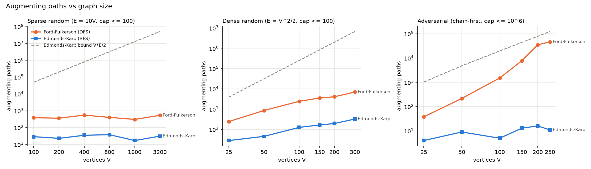

# Benchmark Report: Ford-Fulkerson vs Edmonds-Karp

## Setup

Both algorithms use the same `FlowNetwork` class and the same loop for sending flow (`MaxFlow.kt`). The only difference is that one finds paths with DFS and the other with BFS, so any speed difference comes from which paths they choose. I tested three kinds of graphs with 6 sizes each (`BenchmarkGraphs.kt`, fixed random seed):

| Kind of graph | Sizes (V) | Edges | Capacities |
|---|---|---|---|
| Sparse random | 100 to 3200 | 10 per vertex | 1 to 100 |
| Dense random | 25 to 300 | about half of all possible edges | 1 to 100 |
| Adversarial | 25 to 250 | about 4 per vertex | 1 to 1,000,000 |

### The adversarial graph

The usual textbook bad case is a 4-vertex graph with a capacity-1 edge in the middle, where the algorithm keeps picking paths that go back and forth across it. That example doesn't actually trick my DFS. DFS always tries edges in the same order, so once the middle edge is full it just takes the big edge next to it. I also tried thousands of small random graphs with a script and couldn't find one that does. So I built a graph around what DFS really does wrong, which is following the first edge it sees as deep as it can:

- each vertex's first edge goes to the next vertex (v → v+1), so DFS dives down one long chain;
- each vertex also has 3 random shortcut edges, so short paths exist;
- capacities are random numbers up to 1,000,000.

A long path's bottleneck is the smallest of many random numbers, so it's usually small. Each time DFS sends flow, it also creates reverse edges that send the next DFS on another long trip. BFS uses the short paths, which have bigger bottlenecks.

### Handling JVM warm-up

The JVM runs code slowly at first and only compiles a function into fast machine code after it has been called a lot. My proposal planned to use kotlinx-benchmark (JMH) for this, but that needs Gradle, and I build with plain `kotlinc`. So `Benchmark.kt` does it by hand, like in HW5:

1. Before timing anything, it runs both algorithms on every graph for at least 0.3 seconds and throws those times away.
2. All the graphs are built before timing starts.
3. Each case then runs for about 2 seconds (5 to 200 times), and I report the median, which ignores one-off slow runs.

I ran it on Windows 11 with Java 21. The raw times are in `results/benchmarks.csv`, and the number of paths is in `results/counts.csv`.

## Results

| Graph | V | E | Ford-Fulkerson (ms) | Edmonds-Karp (ms) | FF slower by |
|---|---|---|---|---|---|
| sparse | 100 | 1,000 | 7.21 | 0.41 | 17x |
| sparse | 3200 | 32,000 | 444.6 | 21.1 | 21x |
| dense | 25 | 312 | 0.88 | 0.062 | 14x |
| dense | 300 | 45,000 | 2097 | 59.7 | 35x |
| adversarial | 25 | 82 | 0.067 | 0.003 | 20x |
| adversarial | 100 | 392 | 18.0 | 0.069 | 260x |
| adversarial | 250 | 988 | 2268 | 0.397 | 5,700x |

All 18 sizes are in `results/benchmark_output.txt`.

## How this matches the theory

The runtime is basically (number of paths) × (time for one search). One DFS or BFS is O(E), and dividing each time by (paths × E) gives about 4 to 55 nanoseconds per edge in every case, for both algorithms. So one algorithm is faster because it needs fewer paths, and that's what the theory is about.

### Edmonds-Karp: O(V · E²)

The proof says Edmonds-Karp needs at most V·E/2 paths, each costing O(E). The real counts were far below that limit (the dashed line in the second plot). Dense V = 300 used 324 paths when the limit is 6,750,000. Sparse V = 3200 used 31 when the limit is 51,200,000. The adversarial graphs used 4 to 16 at every size. So O(VE²) holds, but it's a very pessimistic worst case. The times match the small path counts:

- dense: time grew about like V^2.8, which fits paths (about V) × E (about V²) = V³, well under the limit's V⁵;
- sparse: about V^1.1;
- adversarial: about V^2.1.

The adversarial graph shows the key point of the bound: Edmonds-Karp's path count doesn't depend on the capacities. It pushed over a million units of flow in 11 paths.

### Ford-Fulkerson: O(E · F), where F is the max flow value

This bound depends on how much flow there is, and the results show it:

- On the random graphs, DFS's long paths usually have a bottleneck of just 1, so it needs about one path per unit of flow. For dense V = 300 the max flow is 7,012 and Ford-Fulkerson used 6,959 paths. That's why it was 14 to 47 times slower even on normal graphs.
- On the adversarial graph, the path count blows up: 38, 216, 1,513, 7,781, 35,097, 46,157 as V goes from 25 to 250. Time grew about like V^4.5, compared to V^2.1 for Edmonds-Karp. It's still under E · F (about 1,000,000,000 here), because long paths usually carry more than 1 unit. But it shows what the bound warns about: with big capacities, DFS's runtime depends on the capacities and its path choices, not just the graph size.

One odd result: sparse V = 1600 was faster than V = 800 for both algorithms. That graph happens to have a smaller max flow (308 compared to 405) and needs fewer paths. That's more evidence that runtime follows the number of paths, not just size.

## Summary

Edmonds-Karp was faster on every graph, from 14 times up to about 5,700 times faster. For both algorithms, time is (number of paths) × O(E). Edmonds-Karp needs very few paths, far under its V·E/2 limit, whatever the capacities. Ford-Fulkerson with DFS needs about one path per unit of flow on random graphs, and on the adversarial graph its path count grows much faster than the graph.
